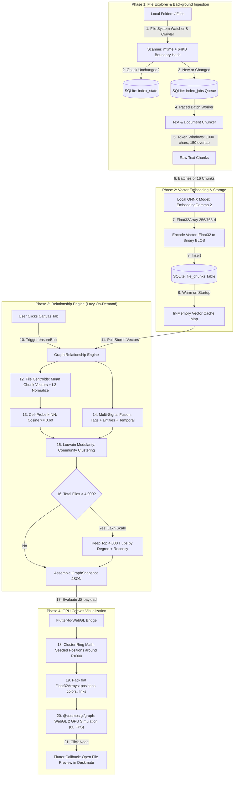
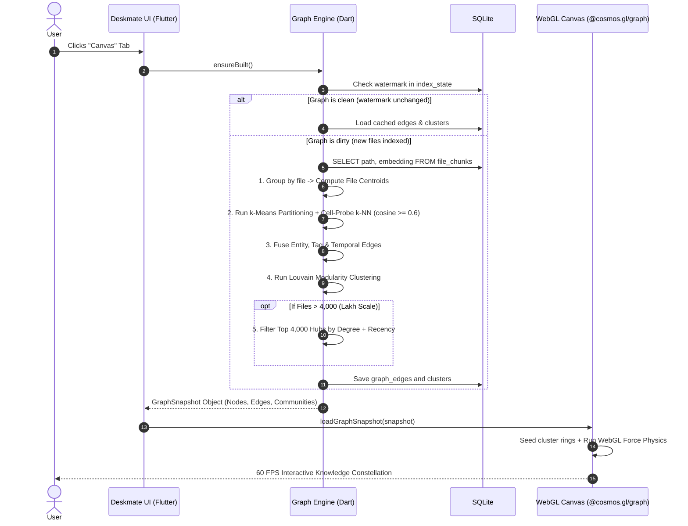

# Deskmate: Knowledge Graph & Vector Pipeline Architecture

> **Complete architectural blueprint and implementation specification for Deskmate.**  
> Documents the full end-to-end lifecycle: **File Explorer Crawling → Differential Hash → Text Extraction & Chunking → Vector Storage in SQLite → Centroid & k-NN Graph Assembly → GPU Canvas Visualization.**

---

## 1. End-to-End System Architecture



---

## 2. Phase 1: File Explorer & Background Ingestion Pipeline

### A. The Ingestion Principle: Never Block the UI
- **Never embed files during search or upon request.**
- Ingestion runs continuously in a low-priority background thread (a Dart `Isolate` or dedicated worker).
- **Cooperative Duty-Cycle (Pacing):** When the user is actively typing, the indexer sleeps 50% of the time to keep the machine cool and save battery.

### B. Fast Change Detection (64KB Boundary Hash)
Re-embedding an entire file just because `mtime` changed (e.g. `git checkout` or backup sync) is wasteful. Deskmate checks a lightweight boundary hash:

```text
[ File on Disk ] ─── Read First 64 KB ───┐
                 ─── Read Last 64 KB  ───┴──> SHA-256 Hash (16 hex chars)
```

If `size` and this `16-character hash` match the row in `index_state`, the file is skipped instantly without touching the vector model.

### C. Two-Pass Strategy for Large Documents & Books
1. **Pass 1 (Immediate Search Utility):**
   - PDFs: Index only the first **50 pages**.
   - Large Documents: Index only the first **40 chunks**.
   - *Result:* A 500-page book or 100,000-file folder becomes searchable within minutes.
2. **Pass 2 (Background Completion):**
   - Runs only when the queue is idle. Reads remaining pages in steps of 30 pages.

---

## 3. Phase 2: Vector Embedding & Storage Engine

### A. Database Schema (SQLite)

```sql
-- 1. Tracks crawler watermark and change detection
CREATE TABLE IF NOT EXISTS index_state (
  path TEXT PRIMARY KEY,
  mtime INTEGER NOT NULL,
  size INTEGER NOT NULL,
  content_hash TEXT NOT NULL,
  indexed_at INTEGER NOT NULL,
  status TEXT CHECK(status IN ('indexed', 'errored', 'skipped'))
);

-- 2. Persistent queue for the background worker
CREATE TABLE IF NOT EXISTS index_jobs (
  path TEXT PRIMARY KEY,
  priority INTEGER DEFAULT 0, -- 0: text, 1: images, 2: pdf, 3: large media
  attempts INTEGER DEFAULT 0,
  added_at INTEGER NOT NULL
);

-- 3. Stored chunk vectors
CREATE TABLE IF NOT EXISTS file_chunks (
  id INTEGER PRIMARY KEY AUTOINCREMENT,
  path TEXT NOT NULL,
  chunk_index INTEGER NOT NULL,
  text TEXT NOT NULL,
  embedding BLOB NOT NULL, -- Float32 binary bytes
  FOREIGN KEY (path) REFERENCES index_state(path) ON DELETE CASCADE
);

CREATE INDEX IF NOT EXISTS idx_chunks_path ON file_chunks(path);
```

### B. Binary Vector Codec (Zero JSON Overhead)
Vectors are stored as raw 4-byte `Float32` byte buffers, reducing disk storage by **75%** compared to JSON strings:

```dart
import 'dart:typed_data';

// Pack Float32List into SQLite BLOB (Uint8List)
Uint8List encodeVector(Float32List vec) {
  return vec.buffer.asUint8List(vec.offsetInBytes, vec.lengthInBytes);
}

// Unpack SQLite BLOB back into Float32List
Float32List decodeVector(Uint8List bytes) {
  return bytes.buffer.asFloat32List(bytes.offsetInBytes, bytes.lengthInBytes ~/ 4);
}
```

---

## 4. Phase 3: Relationship Engine & Graph Creation Flow

The graph is **never built eagerly**. It is computed **lazily** only when the user opens the Canvas tab.



### A. The Document Centroid Equation
A file with $M$ chunks is represented by a single unit-normalized mean vector:

$$\vec{c}_{\text{file}} = \frac{\sum_{i=1}^M \vec{v}_i}{\left\|\sum_{i=1}^M \vec{v}_i\right\|_2}$$

Because $\vec{c}_{\text{file}}$ has unit length ($\|\vec{c}\| = 1$), cosine similarity between document $A$ and document $B$ is a fast dot product:

$$\text{similarity}(A, B) = \vec{c}_A \cdot \vec{c}_B = \sum_{d=1}^{D} c_{A,d} \cdot c_{B,d}$$

### B. Louvain Modularity (Community Coloring)
Nodes are grouped using Louvain Community Detection into clusters. Each cluster receives one of Deskmate's five signature accent colors:

| Community ID | Palette Name | Hex Code | Visual Meaning |
| :---: | :--- | :--- | :--- |
| **0** | **Blueberry** | `#6e9bee` | Engineering, Code, Technical Docs |
| **1** | **Mint** | `#4fc9b8` | Finance, Invoices, Spreadsheets |
| **2** | **Grape** | `#a585e0` | Research, Books, Personal Notes |
| **3** | **Mango** | `#f9a85c` | Media, Creative, Photos |
| **4** | **Strawberry**| `#f26d6d` | Administrative, System, Project Plans |

---

## 5. Phase 4: GPU Canvas Visualization & WebGL Bridge

### A. Layout Seeding (The Cluster Ring)
To prevent nodes from exploding outward from a random point cloud, nodes are positioned around **cluster centers**:
- The virtual space size is $4096 \times 4096$ with center at $(2048, 2048)$.
- Clusters sit on a ring of radius $R = 900$:

$$\theta_c = \frac{2\pi \cdot \text{clusterId}}{\text{clusterCount}}$$

$$x_i = 2048 + 900\cos(\theta_c) + \text{jitter}_x, \quad y_i = 2048 + 900\sin(\theta_c) + \text{jitter}_y$$

### B. Decoupled Structure vs. Paint
To guarantee 60–120 FPS performance:
- **Structural Updates (rare):** Changing filter chips or opening Canvas uploads links and runs `graph.start(0.9)`.
- **Visual Interactions (frequent):** Typing in search spotlight or hovering a node **never reheats physics**. It updates only the color and point-size buffers directly on the GPU via `graph.graph.updatePointColor()`.

---

## 6. How to Handle "Lakh" Scale (100,000+ Files)

When your database scales to lakhs of files:

1. **Truncation Budget (`MAX_NODES = 4,000`):**
   - The database indexes all 500,000 files.
   - The Canvas renders the top 4,000 **most interconnected and recent hubs**.
   - Isolated files with degree $= 0$ are hidden from the macro constellation.
2. **Dimension Truncation (256-d Matryoshka):**
   - Truncate 768-d vectors down to 256 dimensions.
   - Retains 98% semantic retrieval accuracy while slashing RAM from 3.1 GB to **~100 MB**.
3. **Semantic Drill-down:**
   - User clicks a cluster hub $\rightarrow$ Deskmate filters the SQLite query to show the sub-graph for that specific cluster.

---

## 7. Deskmate Implementation Checklist

- [ ] **Step 1:** Create `index_state` and `file_chunks` tables in SQLite.
- [ ] **Step 2:** Implement background crawler in a Dart `Isolate` with 64KB boundary hashing.
- [ ] **Step 3:** Batch embeddings in groups of 16 using local ONNX (`EmbeddingGemma 2`).
- [ ] **Step 4:** Store vectors as raw binary `Float32` BLOBs.
- [ ] **Step 5:** On Canvas tab open, calculate centroids and k-NN edges ($\text{cosine} \ge 0.60$).
- [ ] **Step 6:** Assign community clusters using Louvain clustering.
- [ ] **Step 7:** Cap nodes at 4,000 hubs for 60 FPS GPU performance.
- [ ] **Step 8:** Embed `@cosmos.gl/graph` inside Flutter via `InAppWebView` with a bidirectional click event bridge.

---

## 8. Cosmos.gl (`@cosmos.gl/graph`) Official Resources & Links

| Resource | URL | Description |
| :--- | :--- | :--- |
| **GitHub Repository** | [github.com/cosmosgl/graph](https://github.com/cosmosgl/graph) | Official open-source repository hosted under the **OpenJS Foundation**. |
| **Interactive Docs & Demos** | [cosmosgl.github.io/graph](https://cosmosgl.github.io/graph) | Live interactive documentation, parameter playgrounds, and visual demos. |
| **Official Web App** | [cosmograph.app](https://cosmograph.app) | Production web visualizer showcasing massive network graphs and embeddings. |
| **GitHub Wiki** | [github.com/cosmosgl/graph/wiki](https://github.com/cosmosgl/graph/wiki) | Guides on API configuration, simulation physics parameters, and event handlers. |
| **NPM Package** | [npmjs.com/package/@cosmos.gl/graph](https://www.npmjs.com/package/@cosmos.gl/graph) | Package used in FilDOS (`^3.1.0`). |

### CDN Links (For Flutter `InAppWebView`)
To load Cosmos.gl directly inside a Flutter local asset view without bundling Node:

- **jsDelivr CDN:**
  ```html
  <script src="https://cdn.jsdelivr.net/npm/@cosmos.gl/graph@3.1.0/dist/cosmos.min.js"></script>
  ```
- **unpkg CDN:**
  ```html
  <script src="https://unpkg.com/@cosmos.gl/graph@3.1.0/dist/cosmos.min.js"></script>
  ```

### Key Technical Advantages for Deskmate
- **WebGL2 & luma.gl Backend:** Computations and particle rendering execute directly on GPU compute/fragment shaders, avoiding CPU memory bottlenecks.
- **Hardware-Accelerated Physics:** Simulates gravity, repulsion, and spring link elasticity directly on the GPU, enabling 60–120 FPS frame rates even with thousands of document nodes.
- **Decoupled Attributes:** Allows in-place updates of point colors (`updatePointColor()`) and sizes for instant search spotlighting without reheating or restarting the simulation.

