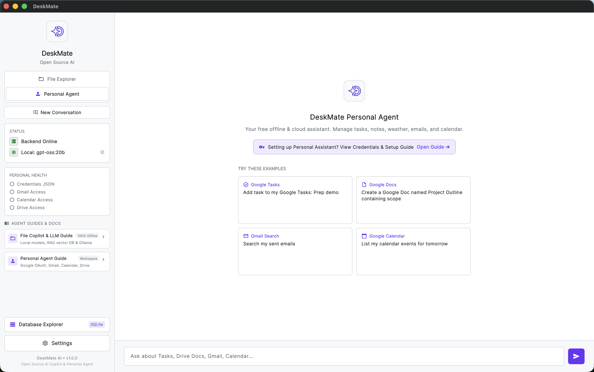
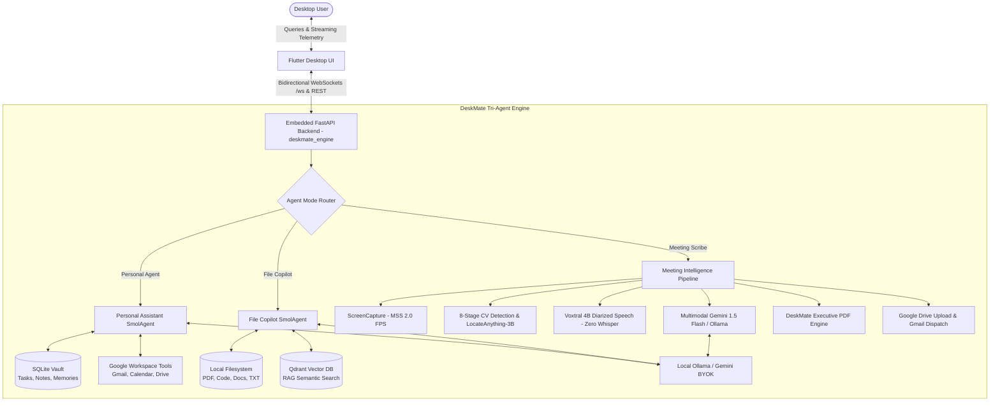

# DeskMate

<p align="center">
  <a href="https://github.com/Ganeshvenkatesanofficial/DeskMate/releases"></a>
  
  
  
  
  
</p>

<p align="center">
  
</p>

**DeskMate** is a free, privacy-first open-source AI desktop copilot and personal assistant. Built with **Flutter Desktop** (GitHub Primer design system) and an embedded **FastAPI + SmolAgents** backend, DeskMate runs 100% offline and natively on your computer with zero cloud telemetry.

---

## ✨ Core Features & Tri-Agent Capabilities

<table>
  <tr>
    <td width="50%" valign="top">
      <h3>📁 File Copilot (100% Offline)</h3>
      <ul>
        <li><b>Local Filesystem Discovery</b>: Seamlessly search, read, and navigate local codebases, documents, and directories.</li>
        <li><b>Multi-Format Intelligence</b>: Native parsing of Source Code, PDFs, Markdown, JSON, YAML, and Images.</li>
        <li><b>Local Codebase RAG</b>: Semantic document search and indexing powered by embedded <b>Qdrant</b> &amp; <b>FastEmbed</b>.</li>
        <li><b>Zero Cloud Exposure</b>: 100% air-gapped execution on local GPU/CPU.</li>
      </ul>
    </td>
    <td width="50%" valign="top">
      <h3>👤 Personal Assistant</h3>
      <ul>
        <li><b>Google Workspace Ecosystem</b>: Bi-directional access to Gmail, Calendar, Drive, and Google Docs with secure OAuth.</li>
        <li><b>Local SQLite Vault</b>: Full CRUD management of daily tasks, quick notes, and structured personal data.</li>
        <li><b>Episodic FAISS Memory</b>: Recalls user preferences, past decisions, and conversational facts with semantic search.</li>
        <li><b>Web Research &amp; Weather</b>: Live DuckDuckGo queries and weather data.</li>
      </ul>
    </td>
  </tr>
  <tr>
    <td width="50%" valign="top">
      <h3>🎙️ Meeting Scribe &amp; Intelligence</h3>
      <ul>
        <li><b>8-Stage Computer Vision</b>: Non-blocking 2.0 FPS screen change detection, cursor tracking, and UI interaction logging.</li>
        <li><b>NVIDIA LocateAnything-3B</b>: Visual UI grounding with high-speed Parallel Box Decoding (PBD).</li>
        <li><b>Voxtral 4B Diarization</b>: Speech-to-text with native multi-speaker recognition (<i>Zero Whisper</i>).</li>
        <li><b>Executive PDF &amp; Cloud Sync</b>: Auto-generates styled PDF briefs and uploads directly to Google Drive &amp; Gmail.</li>
      </ul>
    </td>
    <td width="50%" valign="top">
      <h3>⚡ Native Desktop Experience</h3>
      <ul>
        <li><b>Live Streaming Telemetry</b>: Real-time accordion displaying LLM reasoning steps, tool calls, and execution latencies.</li>
        <li><b>Dynamic Local LLM Discovery</b>: Auto-detects local <b>Ollama</b> models (<code>llama3.2</code>, <code>mistral</code>, <code>qwen2.5</code>, <code>deepseek-r1</code>).</li>
        <li><b>In-App SQLite Explorer</b>: Inspect and query your agent database tables directly with an interactive console.</li>
        <li><b>GitHub Primer UI</b>: Sleek, high-contrast dark &amp; light themes with custom DeskMate purple accents.</li>
      </ul>
    </td>
  </tr>
</table>

---

## 🚀 Quick Install

### 🍏 macOS
Run this command in Terminal to install DeskMate into `/Applications`:
```bash
curl -fsSL https://raw.githubusercontent.com/Ganeshvenkatesanofficial/DeskMate/main/.github/scripts/install.sh | bash
```
*Or download **`DeskMate-macOS.dmg`** directly from [Releases](https://github.com/Ganeshvenkatesanofficial/DeskMate/releases).*

### 🪟 Windows
Run this command in PowerShell (`Win + X` → **Terminal**):
```powershell
irm https://raw.githubusercontent.com/Ganeshvenkatesanofficial/DeskMate/main/.github/scripts/install.ps1 | iex
```
*Or download **`DeskMate-Windows.zip`** directly from [Releases](https://github.com/Ganeshvenkatesanofficial/DeskMate/releases).*

---

## 🏗️ Architecture



---

## 🌟 Open Source Technologies & Models

DeskMate is built upon world-class open-source projects, models, and libraries. Below is the breakdown of technologies powering each subsystem:

| Technology / Model | Official Repository / Model Page | Role in DeskMate | Implementation Location |
| :--- | :--- | :--- | :--- |
| **NVIDIA LocateAnything-3B** | [nvidia/LocateAnything-3B](https://huggingface.co/nvidia/LocateAnything-3B) | Visual UI Grounding & Parallel Box Decoding (PBD) for detecting buttons, menus, and controls | [`deskmate_engine/services/meeting_intelligence/modules/locate_anything.py`](file:///Users/entrans/DeskMate/deskmate_engine/services/meeting_intelligence/modules/locate_anything.py) |
| **Mistral Voxtral 4B Realtime** | [mistralai/Voxtral-Mini-4B-Realtime-2602](https://huggingface.co/mistralai/Voxtral-Mini-4B-Realtime-2602) | Real-time speech transcription with native multi-speaker diarization (*Zero Whisper*) | [`deskmate_engine/services/meeting_intelligence/transcriber/voxtral_service.py`](file:///Users/entrans/DeskMate/deskmate_engine/services/meeting_intelligence/transcriber/voxtral_service.py) |
| **Hugging Face SmolAgents** | [huggingface/smolagents](https://github.com/huggingface/smolagents) | Autonomous multi-step tool execution, reasoning loops, and streaming thought telemetry | [`deskmate_engine/services/file_copilot/agent.py`](file:///Users/entrans/DeskMate/deskmate_engine/services/file_copilot/agent.py), [`services/personal_assistant/agent.py`](file:///Users/entrans/DeskMate/deskmate_engine/services/personal_assistant/agent.py) |
| **Ollama** | [ollama/ollama](https://github.com/ollama/ollama) | 100% offline, air-gapped local LLM inference engine (`llama3.2`, `mistral`, `qwen2.5`, `deepseek-r1`) | [`deskmate_engine/core/models.py`](file:///Users/entrans/DeskMate/deskmate_engine/core/models.py) |
| **Qdrant & FastEmbed** | [qdrant/qdrant](https://github.com/qdrant/qdrant) \| [qdrant/fastembed](https://github.com/qdrant/fastembed) | Embedded local vector database and fast ONNX embeddings for offline codebase semantic search | [`deskmate_engine/services/file_copilot/rag_tools.py`](file:///Users/entrans/DeskMate/deskmate_engine/services/file_copilot/rag_tools.py) |
| **FAISS** | [facebookresearch/faiss](https://github.com/facebookresearch/faiss) | Dense vector similarity search for personal assistant long-term episodic memory recall | [`deskmate_engine/services/personal_assistant/tools.py`](file:///Users/entrans/DeskMate/deskmate_engine/services/personal_assistant/tools.py) |
| **OpenCV (cv2)** | [opencv/opencv](https://github.com/opencv/opencv) | SSIM visual dedup, Canny edge detection, contour bounding box evaluation, and cursor tracking | [`deskmate_engine/services/meeting_intelligence/modules/`](file:///Users/entrans/DeskMate/deskmate_engine/services/meeting_intelligence/modules/) |
| **MSS** | [BoboTiG/python-mss](https://github.com/BoboTiG/python-mss) | Ultra-fast, zero-overhead background screen capture at 2.0 FPS | [`deskmate_engine/services/meeting_intelligence/screen_capture.py`](file:///Users/entrans/DeskMate/deskmate_engine/services/meeting_intelligence/screen_capture.py) |
| **SoundDevice & SoundFile** | [spatialaudio/python-sounddevice](https://github.com/spatialaudio/python-sounddevice) \| [bastibe/python-soundfile](https://github.com/bastibe/python-soundfile) | System loopback / earphone audio capture and real-time PCM microphone mute gating | [`deskmate_engine/services/meeting_intelligence/transcriber/live_audio_recorder.py`](file:///Users/entrans/DeskMate/deskmate_engine/services/meeting_intelligence/transcriber/live_audio_recorder.py) |
| **FPDF2** | [py-pdf/fpdf2](https://github.com/py-pdf/fpdf2) | Production vector PDF layout engine for DeskMate executive meeting intelligence reports | [`deskmate_engine/services/meeting_intelligence/pdf_generator.py`](file:///Users/entrans/DeskMate/deskmate_engine/services/meeting_intelligence/pdf_generator.py) |
| **FastAPI & Uvicorn** | [fastapi/fastapi](https://github.com/fastapi/fastapi) \| [encode/uvicorn](https://github.com/encode/uvicorn) | Asynchronous backend web framework and bidirectional WebSocket streaming (`/ws/*`) | [`deskmate_engine/backend.py`](file:///Users/entrans/DeskMate/deskmate_engine/backend.py), [`routers/`](file:///Users/entrans/DeskMate/deskmate_engine/routers/) |
| **Flutter Desktop** | [flutter/flutter](https://github.com/flutter/flutter) | Cross-platform desktop interface styled with GitHub Primer design tokens and dark/light modes | [`deskmate_app/`](file:///Users/entrans/DeskMate/deskmate_app/) |

---

## 🛠️ Local Development

### 1. Python Backend
```bash
cd deskmate_engine
python3 -m venv .venv && source .venv/bin/activate
pip install -r requirements.txt
python backend.py --port 8080
```

### 2. Flutter Desktop
```bash
cd deskmate_app
flutter pub get
flutter run -d macos   # or: flutter run -d windows
```

---

## 📖 User Guide & Model Architecture

### 🧠 Dynamic Model Selection & Capabilities
DeskMate automatically discovers all models installed in your local Ollama instance (`http://127.0.0.1:11434`) and dynamically identifies their specialized capabilities:
* **Multimodal Vision & Visual Intelligence**: Detected for models with vision weights (e.g., `llama3.2-vision:latest`, `llava`, `moondream`).
* **Optimized for Fast Coding & Development**: Detected for code-specialized architectures (e.g., `qwen2.5-coder:1.5b`, `starcoder`).
* **Advanced Step-by-Step Reasoning**: Detected for chain-of-thought models (e.g., `deepseek-r1:8b`).
* **General Intelligence & Reasoning**: Parameter sizes (e.g., `20B`, `70B`, `8B`) are dynamically parsed for general LLMs (e.g., `gpt-oss:20b`, `llama3.2:3b`).

### 🛡️ How DeskMate Handles Zero Models / Fresh Installations
If you launch DeskMate without any local Ollama models installed, or if Ollama is not running:
1. **Startup Detection**: The backend reports `no_models` or `offline` status via `GET /api/health`.
2. **Sidebar Status Indicators**: 
   - Displays `Reasoning: Offline` (red danger badge) if no model or Gemini key is configured.
   - Displays `Vision: Setup Required` (amber warning badge).
3. **Setup Modal with Copyable Guidance**:
   - The setup dialog presents copyable terminal commands: `ollama run llama3.2` with a 1-click **Re-check Status** button.
   - **Cloud BYOK Bypass**: Users who prefer not to download multi-gigabyte local model weights can enter a Google Gemini API Key to run without local models.
4. **Meeting Scribe Safeguards**:
   - Attempting to record a meeting without a vision model or Gemini key triggers the Visual Intelligence Setup modal, providing immediate 1-click activation for **Lightweight Laptop Mode**.

### 👁️ Visual Intelligence (Meeting Scribe) — 3 Modes
Meeting Scribe supports three flexible operational modes to accommodate any hardware configuration:
1. **Lightweight Laptop Mode (Recommended for 8GB–16GB RAM laptops)**:
   - Zero additional downloads.
   - Uses your active chat model (e.g., `qwen2.5-coder:1.5b`, `gpt-oss:20b`) combined with screen OCR and Voxtral 4B speech diarization to generate comprehensive meeting briefs and action items.
2. **Full Local Vision Mode (High-spec machines with 16GB+ RAM / Dedicated GPU)**:
   - Uses local `llama3.2-vision` in Ollama (`ollama run llama3.2-vision`) for end-to-end pixel and chart understanding.
3. **Google Gemini Cloud Vision (Zero Local RAM)**:
   - Uses `gemini-1.5-flash` in Google Cloud for ultra-fast, zero-memory multimodal reasoning with your own API key.

---

## 🤝 Contributing
Contributions are welcome! Please check out [CONTRIBUTING.md](.github/CONTRIBUTING.md) to get started.

---

## ⭐ Star History

<p align="center">
  <a href="https://star-history.com/#Ganeshvenkatesanofficial/DeskMate&Date">
    
  </a>
</p>

---

## 📄 License
This project is open-source under the [MIT License](LICENSE).
