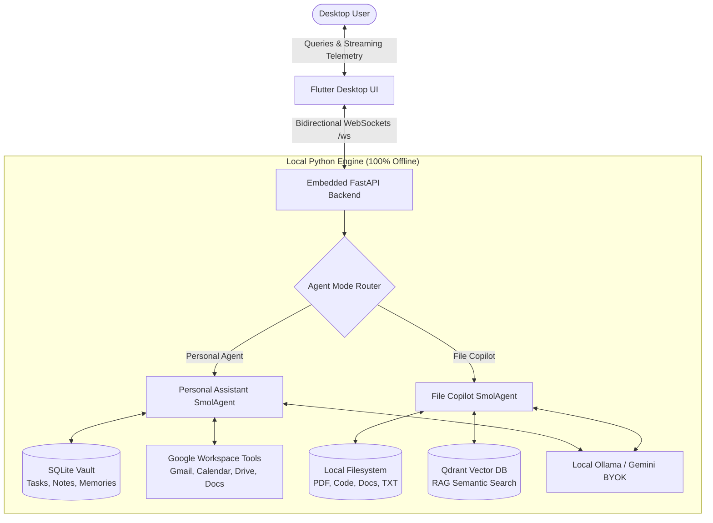

# DeskMate

<p align="center">
  <a href="https://github.com/Ganeshvenkatesanofficial/DeskMate/releases"></a>
  
  
  
  
  
</p>

<p align="center">
  
</p>

**DeskMate** is a free, privacy-first open-source AI desktop copilot and personal assistant. Built with **Flutter Desktop** (GitHub Primer design system) and an embedded **FastAPI + SmolAgents** backend, DeskMate runs 100% offline and natively on your computer with zero cloud telemetry.

---

## ✨ Features

* **📁 File Copilot (100% Offline)**: Direct local filesystem navigation, recursive file search, multi-format reading (Code, PDF, Markdown, Images), and local semantic search powered by Qdrant vector database.
* **👤 Personal Assistant**: 30 tools covering tasks, quick notes, personal memories, Google Workspace (Gmail, Calendar, Drive, Docs), weather, and web search.
* **⚡ Live Step-by-Step Telemetry**: Expandable accordion displaying the agent's real-time thought process, tool execution details, latency, and observations.
* **🧠 Dynamic Local LLM Support**: Automatically discovers your local [Ollama](https://ollama.com) models (`llama3.2`, `mistral`, `qwen2.5`, `deepseek-r1`) with optional Gemini BYOK cloud reasoning.
* **🗄️ In-App SQLite Explorer**: Browse and query your local agent memory vault, task lists, and notes directly inside the app with a built-in SQL console.
* **🔒 Privacy by Design**: All files, code, and SQLite databases stay strictly on your local machine.

---

## 🚀 Quick Install

### 🐧 Linux (Any Distribution)
Run this command in your Terminal to automatically install DeskMate:
```bash
curl -fsSL https://raw.githubusercontent.com/Ganeshvenkatesanofficial/DeskMate/main/install.sh | bash
```

#### Running Directly from Portable `tar.gz`:
1. Download **`DeskMate-Linux-x64.tar.gz`** from [Releases](https://github.com/Ganeshvenkatesanofficial/DeskMate/releases).
2. Extract the archive:
   ```bash
   tar -xzf DeskMate-Linux-x64.tar.gz
   cd DeskMate
   ```
3. Run natively:
   ```bash
   ./run.sh
   # or run the executable directly:
   ./DeskMate
   ```
4. *(Optional)* Integrate into your desktop application menu:
   ```bash
   ./install_linux.sh
   ```

### 🍏 macOS
Run this command in Terminal to install DeskMate into `/Applications`:
```bash
curl -fsSL https://raw.githubusercontent.com/Ganeshvenkatesanofficial/DeskMate/main/install.sh | bash
```
*Or download **`DeskMate-macOS.dmg`** directly from [Releases](https://github.com/Ganeshvenkatesanofficial/DeskMate/releases).*

### 🪟 Windows
Run this command in PowerShell (`Win + X` → **Terminal**):
```powershell
irm https://raw.githubusercontent.com/Ganeshvenkatesanofficial/DeskMate/main/install.ps1 | iex
```
*Or download **`DeskMate-Windows.zip`** directly from [Releases](https://github.com/Ganeshvenkatesanofficial/DeskMate/releases).*

---

## 🏗️ Architecture



---

## 🛠️ Local Development

### 1. Python Backend
```bash
cd terminal-ai-agent
python3 -m venv .venv && source .venv/bin/activate
pip install -r requirements.txt
python backend.py --port 8080
```

### 2. Flutter Desktop
```bash
cd deskmate_app
flutter pub get
flutter run -d linux   # or: flutter run -d macos / windows
```

---

## 🤝 Contributing
Contributions are welcome! Please check out [CONTRIBUTING.md](CONTRIBUTING.md) to get started.

---

## ⭐ Star History

<p align="center">
  <a href="https://star-history.com/#Ganeshvenkatesanofficial/DeskMate&Date">
    
  </a>
</p>

---

## 📄 License
This project is open-source under the [MIT License](LICENSE).
