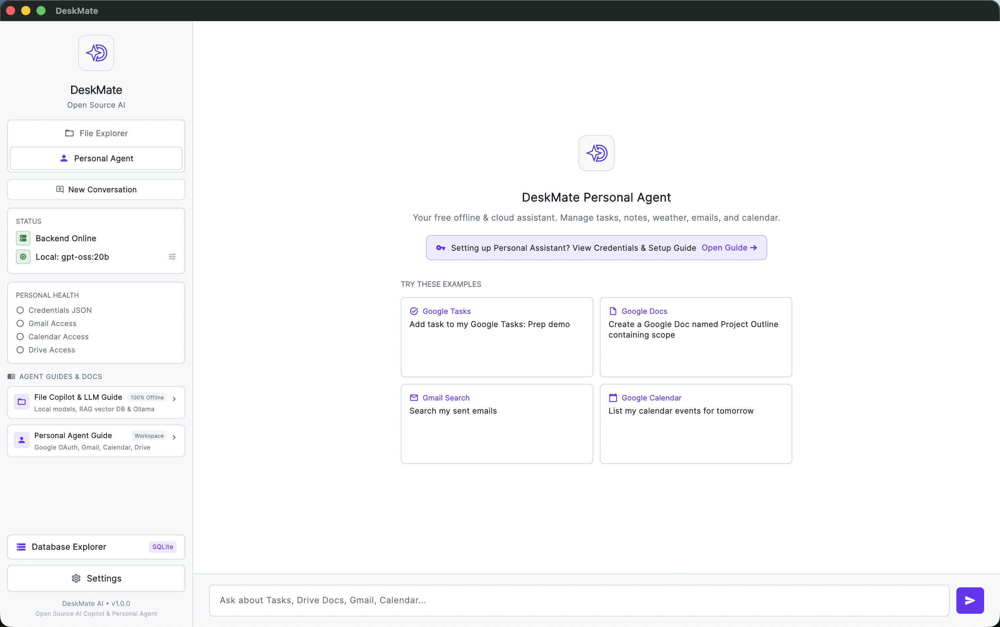

# DeskMate

<p align="center">
  <a href="https://github.com/Ganeshvenkatesanofficial/DeskMate/releases"></a>
  
  
  
  
  
</p>

<p align="center">
  
</p>


**DeskMate** is a free, open-source **AI-native file explorer** for your computer: a real file manager, search by meaning, a chat agent that works on your files, and a map of how your work connects. The app, the index and the models run on your machine; nothing is uploaded unless you choose Gemini in the cloud.

Built with **Flutter** (desktop UI) and an embedded **Python engine** (FastAPI + SmolAgents, FastEmbed + Qdrant, SQLite).

---

## ✨ What DeskMate does

- **A real file manager first.** Icon, list, column and gallery views, Quick Look on <kbd>Space</kbd>, inline rename, drag-and-drop, undo, tags, recents and per-folder view memory. Deletes go to the Trash and nothing is ever overwritten.
- **Search by meaning.** <kbd>⌘K</kbd> searches file names and file contents in one list: text, code, PDFs (opening at the matching page), DOCX, and pictures through the OS's own text recognition. When nothing matches, it says so instead of showing the nearest noise.
- **Ask AI, with live agent logs.** Chat with your files using `@file`, `#folder` and `/find`. The Folder Agent can list, read, find, create, copy, move, rename and trash files, and every reasoning step, tool call and result streams into the chat as it happens.
- **Canvas.** A map of your indexed files linked by similar content, shared names (people, companies, projects), tags and files worked on together, with a timeline you can replay.
- **You stay in control.** You choose which folders are indexed, can hide any file, folder or extension from AI, and secrets (`.env`, SSH keys, credentials) are never read.
- **Your model.** Any local chat model through [Ollama](https://ollama.com) (the first-run tour can install one), or Gemini with your own key.

---

## 🚀 Installation Guide

Choose your operating system below for quick setup instructions:

---

### 🍏 macOS Installation

#### Option 1: 1-Line Terminal Auto-Installer (Recommended)
Open Terminal (`Cmd + Space` → **Terminal**) and run:
```bash
curl -fsSL https://raw.githubusercontent.com/Ganeshvenkatesanofficial/DeskMate/main/.github/scripts/install.sh | bash
```
> **What this does**: Automatically downloads the latest verified release, installs `DeskMate.app` directly into `/Applications`, clears macOS Gatekeeper quarantine locks, signs the binaries, and launches the app.

#### Option 2: Native Disk Image (`.dmg`)
1. Download **`DeskMate-macOS.dmg`** from [Latest Releases](https://github.com/Ganeshvenkatesanofficial/DeskMate/releases).
2. Double-click the downloaded `.dmg` file to mount it.
3. Install using either method inside the window:
   - **Drag & Drop**: Drag the **DeskMate** icon into the **Applications** folder shortcut.
   - **Auto-Installer**: Double-click **`Install DeskMate.command`** to install and configure permissions automatically.
4. Launch **DeskMate** from `/Applications` or Spotlight (`Cmd + Space`).

#### Option 3: Direct ZIP Archive (`.zip`)

**Step-by-Step Instructions After Downloading:**
1. **Download the ZIP**:
   - Download **`DeskMate-macOS.zip`** from [Latest Releases](https://github.com/Ganeshvenkatesanofficial/DeskMate/releases).
2. **Extract the Archive**:
   - In Finder, open your `Downloads` folder and **double-click `DeskMate-macOS.zip`** to extract `DeskMate.app`.
   - *(Or via Terminal)*:
     ```bash
     unzip ~/Downloads/DeskMate-macOS.zip -d ~/Downloads/
     ```
3. **Move to `/Applications`**:
   - Drag **`DeskMate.app`** from `Downloads` into the **Applications** folder in your Finder sidebar.
4. **Bypass macOS Gatekeeper (First Launch Only)**:
   - Because open-source builds are ad-hoc signed, macOS may display *"DeskMate cannot be opened because the developer cannot be verified"*.
   - Choose either quick method to allow it:
     - **Method A (Terminal 1-Liner)**: Run this command in Terminal to strip quarantine flags:
       ```bash
       xattr -cr /Applications/DeskMate.app
       ```
     - **Method B (Finder)**: **Right-click** (or `Control` + Click) `DeskMate.app` in `/Applications` ➔ Click **Open** ➔ Click **Open** in the confirmation dialog.
5. **Launch DeskMate**:
   - Open **DeskMate** directly from `/Applications`, Launchpad, or Spotlight (`Cmd + Space`).

---

### 🪟 Windows Installation

#### Option 1: 1-Line Terminal Auto-Installer (Recommended)
Open PowerShell (`Win + X` → **Terminal** / **PowerShell**) and run:
```powershell
irm https://raw.githubusercontent.com/Ganeshvenkatesanofficial/DeskMate/main/.github/scripts/install.ps1 | iex
```

*Or run using **`curl`** in Command Prompt / Terminal:*
```cmd
curl.exe -fsSL https://raw.githubusercontent.com/Ganeshvenkatesanofficial/DeskMate/main/.github/scripts/install.ps1 -o install.ps1 && powershell -ExecutionPolicy Bypass -File .\install.ps1
```
> **What this does**: Automatically downloads the latest release package, installs to `%LOCALAPPDATA%\DeskMate`, creates desktop and Start Menu shortcuts, and launches the app.

#### Option 2: Direct ZIP Archive (`.zip`)

**Step-by-Step Instructions After Downloading:**
1. **Download the ZIP**:
   - Download **`DeskMate-Windows.zip`** from [Latest Releases](https://github.com/Ganeshvenkatesanofficial/DeskMate/releases).
2. **Extract the Archive**:
   - Right-click `DeskMate-Windows.zip` in your Downloads folder ➔ select **Extract All...**
   - Choose a destination folder (e.g., `C:\Program Files\DeskMate` or `C:\Users\<YourUser>\AppData\Local\DeskMate`) and click **Extract**.
3. **Handle Windows SmartScreen (First Launch Only)**:
   - If Windows Defender SmartScreen displays *"Windows protected your PC"* on launch:
     - Click **More info**.
     - Click **Run anyway**.
4. **Launch DeskMate**:
   - Inside the extracted folder, double-click **`DeskMate.exe`** to run.
   - *(Tip)* Right-click `DeskMate.exe` ➔ select **Pin to Start** or **Pin to taskbar** for one-click access anytime.

---
---

## 🏗️ Architecture

```text
deskmate_app/                Flutter desktop app
  lib/app/                   engine launcher and discovery, theme
  lib/folder_agent/          the UI: shell, explorer views, search, Ask AI,
                             Canvas, onboarding tour, settings
deskmate_engine/             Python engine (bundled with the app)
  backend.py                 FastAPI entry point
  core/                      LLM adapters (Ollama / Gemini), agent telemetry, chat history
  routers/folder_agent/      /api/fa/* REST by area, /ws/folder-events, /ws/folder-agent
  services/folder_agent/     filesystem, index, search, graph and the SmolAgents Folder Agent
```

| Piece | How it works |
|---|---|
| Filesystem | `fs_service.py`: list, info, create, rename, copy, move, duplicate, Trash; name search is breadth-first and tokenized |
| Index | `indexer.py` walks the folders you grant, re-reading only files whose size or date changed; text is chunked and embedded on-device with FastEmbed (BGE Small) into an embedded Qdrant |
| Search | `search.py` fuses filename and meaning hits; meaning hits must stand out from the query's own score distribution |
| Canvas | `graph.py` builds file links (k-NN similarity, shared entities, tags, sessions), Louvain clusters and the layout |
| Models | `ai_config.py`: the engine stores the chosen chat model and Gemini key (set from Settings via `PUT /api/fa/ai/config`; the key is never returned) |
| Agent | `chat_service.py` runs a turn (history, `/find` / `/summarize`, model, persistence); `agent.py` / `tools.py` are the SmolAgents `ToolCallingAgent`; `core/telemetry.py` streams every step over `/ws/folder-agent` with one event schema (see [engine README](deskmate_engine/README.md#agent-telemetry)) |

The file-explorer design is adapted from [FilDOS](https://github.com/ahmedfahim21/FilDOS) (MIT); see [THIRD_PARTY_NOTICES.md](THIRD_PARTY_NOTICES.md). The engine is DeskMate's own.

---

## 🛠️ Local Development

### 1. Python engine
```bash
cd deskmate_engine
python3 -m venv .venv && source .venv/bin/activate
pip install -r requirements.txt
python backend.py --port 2026
python -m pytest tests          # engine tests
```

### 2. Flutter app
```bash
cd deskmate_app
flutter pub get
flutter run -d macos   # or: flutter run -d windows
flutter test           # app tests
```

The app starts the bundled engine itself; in development it reuses one already running on port 2026.

---

## 🤝 Contributing
Contributions are welcome! Please check out [CONTRIBUTING.md](.github/CONTRIBUTING.md) to get started.

---

## ⭐ Star History

<p align="center">
  <a href="https://star-history.com/#Ganeshvenkatesanofficial/DeskMate&Date">
    
  </a>
</p>

---

## 📄 License
This project is open-source under the [MIT License](LICENSE).
