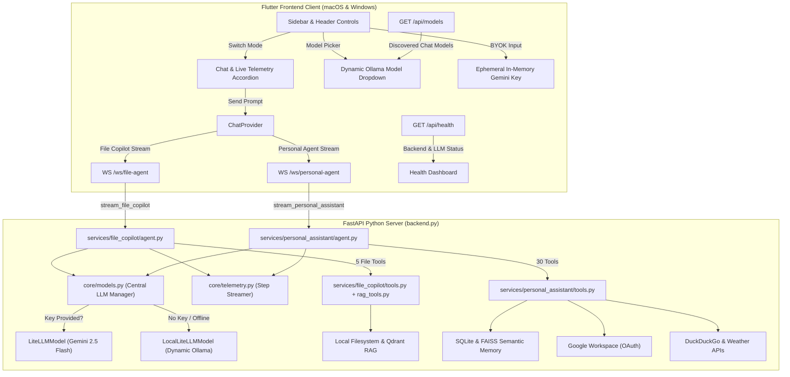

# DeskMate – Open-Source AI Desktop Copilot & Personal Assistant

Welcome to **DeskMate**! A powerful open-source local AI-driven desktop copilot and personal workspace assistant consisting of a **Python AI Backend** (powered by FastAPI, SmolAgents, Qdrant, and FAISS) and a beautiful **Flutter Desktop Frontend** (macOS and Windows).

By bundling the backend as a silent background process inside the Flutter application, **DeskMate runs completely offline, securely, and natively on the client's device without requiring a remote server deployment or manual Python environment setup!**

---

## 🚀 Quick Install (100% Free Open-Source)

### 🍏 macOS

#### One-Line Auto-Install (macOS)
Run this single command in your Terminal. It installs DeskMate directly into your Applications folder and launches immediately with **zero macOS Gatekeeper warnings**:
```bash
curl -fsSL https://raw.githubusercontent.com/Ganeshvenkatesanofficial/DeskMate/main/install.sh | bash
```

#### DMG Click-to-Install (macOS)
1. Download **`DeskMate-macOS.dmg`** from [Releases](https://github.com/Ganeshvenkatesanofficial/DeskMate/releases).
2. Open the disk image and double-click **`Install DeskMate`** to install and open with zero manual setup.

---

### 🪟 Windows

#### One-Line Auto-Install (PowerShell)
Open PowerShell (`Win + X` → **Terminal** or **PowerShell**) and run:
```powershell
irm https://raw.githubusercontent.com/Ganeshvenkatesanofficial/DeskMate/main/install.ps1 | iex
```
*Automatically downloads the latest release, installs DeskMate into `%LOCALAPPDATA%\DeskMate`, creates Desktop & Start Menu shortcuts, and launches immediately!*

#### Portable ZIP (Click-to-Install)
1. Download **`DeskMate-Windows.zip`** from [Releases](https://github.com/Ganeshvenkatesanofficial/DeskMate/releases).
2. Right-click the `.zip` file and select **Extract All...**.
3. Open the extracted folder and double-click **`DeskMate.exe`**.
4. The embedded local Python AI backend launches silently in the background automatically!

---

## Architecture & Security Highlights

### 1. ⚡ Real-Time WebSockets & Agentic Telemetry
* **Live Step Streaming**: Replaced blocking REST calls with bidirectional WebSockets (`/ws/file-agent` and `/ws/personal-agent`).
* **Visual Thought Process**: As `smolagents` reasons and executes tools, live telemetry steps stream to the UI in real time.
* **Collapsible Telemetry Accordion**: Users can expand or collapse the agent's reasoning process (tool calls, arguments, observations) directly in the chat bubble or live while the agent is executing.
* **Zero Waiting in the Dark**: Eliminates blank waiting screens with live feedback on what step the agent is currently executing.

### 2. 🛡️ BYOK (Bring Your Own Key) & Ephemeral Security
* **Zero Disk Persistence**: User-provided Gemini API keys are held strictly in transient application memory (`ChatProvider` RAM). They are **never** written to `SharedPreferences`, `.env`, configuration files, or logs.
* **Hybrid Cloud Reasoning + Local Execution**: When a key is provided, Gemini (e.g. `gemini-2.5-flash`) handles high-level intent parsing and step-by-step reasoning, while all tool actions (reading files, executing SQL, querying FAISS, interacting with Google Workspace) execute **locally on your machine**.
* **Zero-Cloud Fallback**: When no API key is provided, DeskMate operates 100% locally and offline through your installed Ollama model.

### 3. 🧠 Dynamic Local Model Discovery & Central Model Core
* **Central Model Layer**: Centralized model discovery, fallback normalization, and tool-call parsing in `core/models.py`.
* **No Hardcoded Models**: DeskMate dynamically queries the Ollama engine (`/api/tags` and `/api/show`) to detect all installed chat models on your machine (e.g., `gpt-oss:20b`, `llama3.2`, `mistral`, `phi3`, `qwen2.5`, `deepseek-r1`).
* **Smart Filter**: Embed-only models (like `bge-m3`, `nomic-embed`, `all-minilm`) are automatically filtered out.
* **Native Tool-Calling Support**: Enhanced parser supports both standard text completions and native Ollama structured `tool_calls`.

### 4. 🔌 Dynamic Port Assignment & Dual-Service Isolation
* **Clean Service Separation**:
  - `services/file_copilot/`: Filesystem inspection and Qdrant RAG vector retrieval.
  - `services/personal_assistant/`: 30 tools for Google Workspace, SQLite tasks/notes, and FAISS vector memory.
  - `core/`: Shared model service, telemetry stream generator, and configuration.
* **Production Auto-Binding**: In packaged standalone builds, DeskMate dynamically requests port `0` (`findFreePort()`). The OS allocates an unused ephemeral port, preventing port collisions even if other servers are running.
* **Development Auto-Detection**: When running in developer mode, the Flutter frontend automatically probes ports `8080` and `8000`.

### 5. 💬 Smart Multi-Turn Contextualization & Dynamic Query Rewriter (Both Agents)
* **Zero Prompt Bloat**: Eliminates the naive approach of dumping entire conversation logs into agent prompts. Instead, a lightweight sub-80ms rewriter resolves follow-ups into standalone commands.
* **Natural Follow-ups Across Modes**:
  - **📁 File Explorer Copilot**: Seamlessly handles chained queries like *"What files are in core?"* → *"and in services?"* (rewritten as *"What files are in the services directory?"*) or *"read telemetry.py"* → *"show its content"*.
  - **👤 Personal Assistant**: Naturally handles contextual queries like *"What is the weather in SF this weekend?"* → *"in chennai"* (rewritten as *"What is the weather in Chennai this weekend?"*).
* **Adaptive Fallback Hierarchy**: Automatically leverages local lightweight Ollama models (`qwen2.5-coder:1.5b`, `llama3.2:1b/3b`) with sub-80ms latency and $0 cost. If unavailable, falls back to Gemini Flash or directly passes the raw query with zero crashes or lag.
* **Strict Session Isolation**: Context is strictly confined to the active `conversation_id`. Clicking "New Chat" resets history completely with zero context bleeding.

### 6. 🗄️ Inbuilt Visual SQLite Database Explorer & Query Console
* **Direct In-App Database Management**: Click the **"Database Explorer"** button in the sidebar (above Settings) to inspect the local SQLite database (`deskmate_agent.db`) natively.
* **Dual-Mode Visual Explorer**:
  - **Tables & Records**: Browse SQLite tables (`tasks`, `notes`, `memories`) with live row counts, column schemas, real-time in-memory row filtering, and single-click JSON export.
  - **SQL Query Console**: Write and execute safe, read-only `SELECT` SQL queries directly from the desktop app with execution timing benchmarks (e.g., *"3 rows returned in 2ms"*), quick query template chips (`SELECT * FROM tasks WHERE done = 0;`), and dynamic full-width data grid rendering.
* **Full-Width Proportional Alignment**: Designed with Primer typography, auto-expanding text columns, boolean completion badges, priority status chips, and a double-click **Record Inspector** modal.
* **Safe Session Isolation**: Personal records (tasks, notes, memories) are persisted safely on disk in SQLite. Starting a "New Conversation" resets only the active LLM context memory; your database records remain 100% intact and persistent.

---


## Dual‑Service AI Architecture



### Dual-Agent Architecture & Separation

| Feature / Dimension | 📁 File Explorer Copilot | 👤 Personal Workspace Assistant |
| :--- | :--- | :--- |
| **Primary Domain** | Local filesystem, codebases & repositories | Personal life, emails, calendar, tasks, notes |
| **LLM Inference** | **Local LLM via Ollama** (`127.0.0.1:11434`) | Cloud LLM (Gemini BYOK) / Built-in |
| **Privacy & Air-Gap** | **100% Offline / Air-Gapped** (Zero cloud data) | Authorized Google APIs & DuckDuckGo |
| **Vector Engine** | Local Qdrant with FastEmbed | FAISS L2 Semantic Memory (`deskmate_agent.db`) |
| **Setup Required** | Download Ollama & pull model | Zero setup for offline; `credentials.json` for Google |

> 🔒 **Critical Agent Boundary**:
> The **Local LLM is used EXCLUSIVELY by File Explorer Copilot**. It is **NOT** used by or required for the Personal Assistant. Your source code, local folders, and repository files never leave your computer and are never transmitted to external cloud servers.

---

### Service 1: File Explorer Copilot (Local LLM Powered)
An advanced filesystem agent with secure, direct local disk access:
* **Capabilities**: `read_file`, `list_directory`, `search_files`, `index_document`, `search_qdrant`.
* **Semantic Search (RAG)**: Integrated Qdrant instance with local FastEmbed models for fully offline vector lookups.
* **Cross-Platform Path Handling**: Automatically normalises Windows bare drive letters (`D:` → `D:\`) and POSIX paths on macOS/Linux.
* **Local LLM Setup (Ollama)**:
  1. **Install Ollama**:
     - macOS: `brew install ollama` or download from [https://ollama.com](https://ollama.com)
     - Windows: Download installer from [https://ollama.com/download/windows](https://ollama.com/download/windows)
     - Linux: `curl -fsSL https://ollama.com/install.sh | sh`
  2. **Pull a Model**:
     - Fast / 3B: `ollama run llama3.2`
     - Code Refactoring / 7B: `ollama run qwen2.5-coder`
     - Reasoning / 8B: `ollama run deepseek-r1:8b`
  3. **Auto-Detection**: DeskMate detects models at `http://127.0.0.1:11434/api/tags` on launch with zero manual config.

---

### Service 2: DeskMate Personal Assistant (Productivity Powered)
A comprehensive personal workspace assistant featuring **30 class-based tools**:
* **Gmail**: Search, read, send, reply, delete, mark as read.
* **Google Calendar**: List, create, delete, update events.
* **Google Drive & Docs**: Full-text search, read/download with Doc→Text and Sheet→CSV exports, create and trash files.
* **Google Tasks**: List, create, complete tasks synced with your Google account.
* **GitHub**: Search issues/PRs, create new issues.
* **Web Search & Weather**: DuckDuckGo search and wttr.in queries.
* **Local Tasks & Notes**: Persistent SQLite-backed checklists and markdown notes (`deskmate_agent.db`).
* **Semantic Memory**: FAISS L2 vector indexing with MiniLM embeddings and SQLite synchronisation for lifetime persistence.
* **Utilities**: Relative datetime calculators and secure SQLAlchemy SQL engines.

---

## Standalone Run & Releases (Windows & macOS)

### 🪟 Running on Windows
1. Download **`DeskMate-Windows.zip`** from [GitHub Releases](https://github.com/Ganeshvenkatesanofficial/DeskMate/releases).
2. Extract the `.zip` archive.
3. Double-click **`DeskMate.exe`** — the backend launches automatically.
4. Enter your **Gemini API Key** in the sidebar (optional) or use offline models with [Ollama for Windows](https://ollama.com/download/windows) and start chatting!

---

### 🍏 Running on macOS (First-Time Setup)

Because DeskMate is open-source and not signed with a paid Apple Developer certificate, macOS Gatekeeper may show a warning: *"DeskMate.app cannot be opened because it is from an unidentified developer"*.

You can bypass this in **1 second** using either method below:

#### Option A: Quick Right-Click Method (Recommended - No Terminal Needed)
1. Unzip **`DeskMate-macOS-App`** (`DeskMate-macOS.zip`) or mount `DeskMate.dmg`.
2. Move **`DeskMate.app`** into your **`Applications`** folder.
3. **Right-click** (or Control-click) **`DeskMate.app`** and click **Open**.
4. Click **Open** again in the macOS confirmation pop-up.
5. *Done! macOS remembers this choice and you can double-click normally from then on.*

#### Option B: Terminal Command Method
If you prefer using Terminal, remove the quarantine attribute directly:
```bash
# For DeskMate moved to Applications folder:
sudo xattr -rd com.apple.quarantine /Applications/DeskMate.app

# Or for DeskMate in Downloads folder:
xattr -d com.apple.quarantine ~/Downloads/DeskMate.app
```

---

## Developer Setup (Running from Source)

### Prerequisites
| Tool | Version | Notes |
|------|---------|-------|
| Python | 3.9+ | Added to system `PATH` |
| Flutter SDK | Latest stable | Added to system `PATH` |
| Git | Any | For version control |
| Ollama | Latest | Optional; for 100% offline local LLM execution |
| Gemini API Key | — | Optional; BYOK cloud reasoning fallback |

### Step 1: Clone the repository
```bash
git clone https://github.com/Ganeshvenkatesanofficial/DeskMate.git
cd DeskMate
```

### Step 2: Start the Python Backend
```bash
cd terminal-ai-agent

# Create and activate virtual environment
python -m venv .venv
.venv\Scripts\activate       # Windows
# source .venv/bin/activate  # macOS/Linux

# Install dependencies
pip install -r requirements.txt

# Start the server (hot-reload enabled)
python backend.py --port 8000
```
The backend starts on **`http://127.0.0.1:8000`** (or `8080`).

---

## 📡 API & WebSocket Reference

DeskMate provides **two bidirectional WebSockets** for live agent telemetry and **seven REST endpoints** for system inspection and synchronous automation.

### Real-Time WebSocket Streaming

#### 1. File Copilot WebSocket (`/ws/file-agent`)
* **URL**: `ws://127.0.0.1:8000/ws/file-agent`
* **What**: Bidirectional streaming session for filesystem exploration, directory reading, and Qdrant RAG searches.
* **Why**: Streams live tool execution steps (`list_directory`, `read_file`, `search_files`) and LLM reasoning directly to the UI timeline so the user never waits in the dark.

**Connect via CLI:**
```bash
websocat ws://127.0.0.1:8000/ws/file-agent
```

**Send Payload (JSON):**
```json
{
  "action": "chat",
  "message": "List all markdown files in the project root.",
  "conversation_id": "conv_file_01",
  "history": [],
  "model": "gpt-oss:20b",
  "api_key": null
}
```

**Streaming Response Events:**
* `{"type": "status", "title": "Passing to LLM", "message": "LLM is deliberating on the next action..."}`
* `{"type": "telemetry", "step_number": 1, "tool_name": "list_directory", "tool_input": {"directory_path": "."}, "observation": "Found: README.md, backend.py...", "reasoning": "Inspecting directory to find markdown files.", "duration_ms": 52}`
* `{"type": "done", "reply": "Here are the markdown files found: ...", "conversation_id": "conv_file_01", "step_count": 1}`
* `{"type": "error", "error": "Description of error"}`

---

#### 2. Personal Assistant WebSocket (`/ws/personal-agent`)
* **URL**: `ws://127.0.0.1:8000/ws/personal-agent`
* **What**: Bidirectional streaming session for Google Workspace (Gmail, Calendar, Drive), SQLite tasks/notes, and FAISS memory.
* **Why**: Enables step-by-step progress display for multi-tool agentic workflows (e.g., checking calendar ➔ drafting email).

**Connect via CLI:**
```bash
websocat ws://127.0.0.1:8000/ws/personal-agent
```

**Send Payload (JSON):**
```json
{
  "action": "chat",
  "message": "What is on my calendar for tomorrow?",
  "conversation_id": "conv_pers_01",
  "history": []
}
```

---

### REST API Endpoints & `curl` Examples

#### 1. Service Root & Endpoint Directory — `GET /`
* **What**: Returns service identity and available endpoint routes.
* **Why**: Fast ping check to verify server connectivity and discovered endpoints.

```bash
curl -X GET "http://127.0.0.1:8000/"
```

**Response:**
```json
{
  "status": "ok",
  "service": "DeskMate AI Copilot & Personal Assistant",
  "protocols": ["websocket", "rest"],
  "endpoints": {
    "ws_file_agent": "/ws/file-agent",
    "ws_personal_agent": "/ws/personal-agent",
    "rest_health": "/api/health",
    "rest_models": "/api/models",
    "rest_chat": "/api/chat",
    "rest_personal": "/api/personal"
  }
}
```

---

#### 2. System Health & LLM Status — `GET /api/health`
* **What**: Checks server status, local Ollama engine connectivity, and detected models.
* **Why**: Flutter polls this on startup to show the connection indicator and populate the model dropdown.

```bash
curl -X GET "http://127.0.0.1:8000/api/health"
```

**Response:**
```json
{
  "status": "ok",
  "local_llm": "online",
  "models": ["gpt-oss:20b", "llama3.2:latest", "mistral:latest"],
  "default_model": "gpt-oss:20b"
}
```

---

#### 3. Available Chat Models — `GET /api/models`
* **What**: Queries Ollama and lists chat-capable models (filtering out embedding-only models).
* **Why**: Populates the UI model picker dynamically so users can switch models with zero restart.

```bash
curl -X GET "http://127.0.0.1:8000/api/models"
```

**Response:**
```json
{
  "models": ["gpt-oss:20b", "llama3.2:latest", "mistral:latest"]
}
```

---

#### 4. Personal Services Health — `GET /api/personal/health`
* **What**: Validates Google OAuth tokens (Gmail, Calendar, Drive) and SQLite connectivity.
* **Why**: Powers the green/red status dots in the Personal Assistant sidebar.

```bash
curl -X GET "http://127.0.0.1:8000/api/personal/health"
```

**Response:**
```json
{
  "status": "online",
  "checks": {
    "google_credentials_file": true,
    "gmail_token": true,
    "calendar_token": false,
    "drive_token": false,
    "tasks_token": false
  },
  "google_workspace": {
    "gmail": true,
    "calendar": false,
    "drive": false,
    "tasks": false
  },
  "database": {
    "sqlite": true
  }
}
```

---

#### 5. Get Active Credentials Status — `GET /api/personal/credentials`
* **What**: Returns active Google OAuth Client ID preview, masked secret status, and token connection state.
* **Why**: Allows the frontend setup dialog to display the active/protected status without showing blank fields on return visits.

```bash
curl -X GET "http://127.0.0.1:8000/api/personal/credentials"
```

**Response:**
```json
{
  "status": "ok",
  "configured": true,
  "client_id": "1234567890-abcdef.apps.googleusercontent.com",
  "client_id_preview": "1234567890-a...oogleusercontent.com",
  "client_secret_masked": "••••••••••••••••",
  "has_credentials_file": true,
  "credentials_path": "/Users/user/Library/Application Support/DeskMate/credentials.json",
  "tokens": {
    "gmail": true,
    "calendar": false,
    "drive": false,
    "tasks": false
  }
}
```

---

#### 6. Save & Rotate Credentials — `POST /api/personal/credentials`
* **What**: Validates Google OAuth Client ID format, updates `credentials.json`, writes to persistent `.env`, purges stale tokens if the Client ID was rotated, and updates the live runtime environment.
* **Why**: One-click in-app credential configuration without needing terminal access or manual file creation.

```bash
curl -X POST "http://127.0.0.1:8000/api/personal/credentials" \
  -H "Content-Type: application/json" \
  -d '{
    "client_id": "1234567890-abcdef.apps.googleusercontent.com",
    "client_secret": "GOCSPX-yourSecretKeyHere"
  }'
```

**Response:**
```json
{
  "status": "ok",
  "message": "Google credentials validated, saved to .env, and activated successfully.",
  "configured": true,
  "client_id": "1234567890-abcdef.apps.googleusercontent.com",
  "tokens_purged": false,
  "path": "/Users/user/Library/Application Support/DeskMate/credentials.json"
}
```

---

#### 7. Synchronous File Chat (Fallback) — `POST /api/chat`
* **What**: Executes a File Copilot turn synchronously and returns the complete markdown reply.
* **Why**: Fallback for non-WebSocket clients or external terminal automation scripts.

```bash
curl -X POST "http://127.0.0.1:8000/api/chat" \
  -H "Content-Type: application/json" \
  -d '{
    "message": "What folders exist in the project directory?",
    "conversation_id": "test_conv_01",
    "model": "gpt-oss:20b"
  }'
```

**Response:**
```json
{
  "conversation_id": "test_conv_01",
  "reply": "The project contains: `core`, `routers`, `services`, and `deskmate_app`.",
  "model": "gpt-oss:20b"
}
```

---

#### 8. Synchronous Personal Chat (Fallback) — `POST /api/personal`
* **What**: Executes a Personal Assistant turn synchronously.
* **Why**: Scripting and headless task management via simple HTTP POST.

```bash
curl -X POST "http://127.0.0.1:8000/api/personal" \
  -H "Content-Type: application/json" \
  -d '{
    "message": "List my pending tasks.",
    "conversation_id": "test_conv_02"
  }'
```

**Response:**
```json
{
  "conversation_id": "test_conv_02",
  "reply": "You have 1 pending task:\n- [ ] Review quarterly roadmap (Priority: high)",
  "model": "default"
}
```

---

#### 9. Reset Conversation Cache — `POST /api/reset/{conversation_id}`
* **What**: Evicts the in-memory chat session cache keyed by `conversation_id`.
* **Why**: Called when the user clicks "New Chat" or "Reset Chat" to clear context memory.

```bash
curl -X POST "http://127.0.0.1:8000/api/reset/test_conv_01"
```

**Response:**
```json
{
  "status": "ok",
  "message": "Conversation test_conv_01 reset"
}
```

---

#### 10. Database Health & Overview — `GET /api/database/overview`
* **What**: Returns SQLite database connection status, physical storage path, file size in KB, and detailed table summaries with row counts and column definitions.
* **Why**: Powers the Database Explorer header and tables list in the Flutter desktop frontend.

```bash
curl -X GET "http://127.0.0.1:8000/api/database/overview"
```

**Response:**
```json
{
  "status": "ok",
  "path": "/Users/user/Library/Application Support/DeskMate/deskmate_agent.db",
  "size_bytes": 20480,
  "size_kb": 20.0,
  "tables": [
    {
      "name": "tasks",
      "row_count": 3,
      "columns": [
        {"name": "id", "type": "INTEGER", "pk": true},
        {"name": "title", "type": "TEXT", "pk": false},
        {"name": "priority", "type": "TEXT", "pk": false},
        {"name": "due_date", "type": "TEXT", "pk": false},
        {"name": "done", "type": "INTEGER", "pk": false},
        {"name": "created_at", "type": "TEXT", "pk": false}
      ]
    },
    {"name": "notes", "row_count": 2, "columns": [...]},
    {"name": "memories", "row_count": 2, "columns": [...]}
  ]
}
```

---

#### 11. Table Data & Records — `GET /api/database/table/{table_name}`
* **What**: Fetches column definitions and paginated records from a specific SQLite table.
* **Why**: Renders the full-width interactive data table in the Database Explorer.

```bash
curl -X GET "http://127.0.0.1:8000/api/database/table/tasks?limit=50&offset=0"
```

**Response:**
```json
{
  "status": "ok",
  "table": "tasks",
  "total_rows": 3,
  "limit": 50,
  "offset": 0,
  "columns": ["id", "title", "priority", "due_date", "done", "created_at"],
  "rows": [
    {
      "id": 1,
      "title": "in chennai",
      "priority": "medium",
      "due_date": null,
      "done": 0,
      "created_at": "2026-10-18 08:17:44"
    }
  ]
}
```

---

#### 12. Safe Read-Only SQL Query Console — `POST /api/database/query`
* **What**: Safely executes read-only `SELECT` SQL queries and returns columns, rows, and total count.
* **Why**: Executes custom queries written by the user or triggered via quick templates in the UI.

```bash
curl -X POST "http://127.0.0.1:8000/api/database/query" \
  -H "Content-Type: application/json" \
  -d '{
    "query": "SELECT id, title, done FROM tasks WHERE done = 0"
  }'
```

**Response:**
```json
{
  "status": "ok",
  "columns": ["id", "title", "done"],
  "rows": [
    {"id": 1, "title": "in chennai", "done": 0}
  ],
  "count": 1
}
```

---


## 🔒 Conversation & Memory Security

* **In-Memory Working Buffer**: Chat turns are held strictly in transient memory. `conversation_id` serves as the cache key.
* **Instant Eviction**: Resetting chat or closing the app purges all context from RAM. No chat transcripts are saved to disk or sent to the cloud.
* **Persistent Entities**: Only explicit personal data requested by the user (tasks, notes, facts) are stored in the offline SQLite database at `~/Library/Application Support/DeskMate/deskmate_agent.db`.

---

### Step 3: Configure Google Workspace OAuth (Optional)
1. Obtain `credentials.json` from the [Google Cloud Console](https://console.cloud.google.com/).
2. Place it inside the `terminal-ai-agent/` directory or provide `GOOGLE_CLIENT_ID` and `GOOGLE_CLIENT_SECRET` in `.env`.
3. Send a Google-related command (e.g. *"Show my calendar events for tomorrow"*).
4. The backend auto-opens your browser for OAuth consent and caches tokens (`token_gmail.json`, `token_gcal.json`, `token_drive.json`).
5. The sidebar **Personal Services Health** checkmarks will turn green!

### Step 4: Start the Flutter App
Open a **new terminal**:
```bash
cd deskmate_app
flutter pub get

# On macOS:
flutter run -d macos

# On Windows:
flutter run -d windows
```
In development mode, the Flutter app automatically checks `8000` and `8080` to connect to your running backend.

### Step 5: (Optional) Local LLM with Ollama
For fully offline operation without any cloud dependencies:
```bash
# 1. Install Ollama from https://ollama.com
# 2. Pull any chat model of your choice:
ollama pull gpt-oss:20b
# Or: ollama pull llama3.2 / mistral / phi3 / qwen2.5

# 3. Start the Ollama daemon:
ollama serve
```
DeskMate will auto-detect the model, display it in the UI model dropdown, and use it seamlessly!

---

## Packaging for Production

### 1. Compile the Backend to a Standalone Executable
```bash
cd terminal-ai-agent
pip install pyinstaller
pyinstaller --clean deskmate_backend.spec
```

### 2. Copy Executable to Flutter Assets
```powershell
# Windows:
New-Item -ItemType Directory -Path "..\deskmate_app\assets\backend" -Force
Copy-Item -Path "dist\deskmate_backend.exe" -Destination "..\deskmate_app\assets\backend\deskmate_backend.exe" -Force
```
```bash
# macOS:
mkdir -p ../deskmate_app/assets/backend
cp dist/deskmate_backend ../deskmate_app/assets/backend/
```

### 3. Build Flutter Release
```bash
cd ../deskmate_app

# Windows:
flutter build windows --release

# macOS:
flutter build macos --release
```

---

## Project Structure

```
DeskMate/
├── README.md
├── .gitignore
├── terminal-ai-agent/
│   ├── backend.py                    # FastAPI server entry point (mounts WS & REST)
│   ├── main.py                       # CLI entry point
│   ├── core/                         # Shared core architecture
│   │   ├── config.py                 # Cross-platform config, logging & watchdog
│   │   ├── models.py                 # Central LLM engine (Ollama & Gemini)
│   │   └── telemetry.py              # Real-time smolagents step streaming engine
│   ├── services/                     # Specialized agent services
│   │   ├── file_copilot/             # File Explorer service
│   │   │   ├── agent.py              # File copilot agent runner & prompts
│   │   │   ├── tools.py              # Filesystem tools (read, list, search)
│   │   │   └── rag_tools.py          # Local Qdrant RAG tools
│   │   └── personal_assistant/       # Personal Assistant service
│   │       ├── agent.py              # Personal assistant runner & prompts
│   │       └── tools.py              # 30 personal tools (Google, Memory, SQL, Web)
│   ├── routers/                      # Network routing layer
│   │   ├── ws_file_agent.py          # WebSocket: /ws/file-agent
│   │   ├── ws_personal_agent.py      # WebSocket: /ws/personal-agent
│   │   └── api_routes.py             # REST compatibility endpoints
│   ├── requirements.txt
│   └── deskmate_backend.spec         # PyInstaller bundle specification
└── deskmate_app/                     # Flutter desktop frontend (macOS & Windows)
    ├── lib/
    │   ├── models/
    │   │   └── chat_message.dart     # Chat message & AgentStepTelemetry models
    │   ├── providers/
    │   │   └── chat_provider.dart    # Telemetry streaming state, ephemeral BYOK key
    │   ├── screens/
    │   │   └── chat_screen.dart      # Main chat view with live processing UI
    │   ├── services/
    │   │   ├── agent_websocket_client.dart  # WebSocket client with live step callback
    │   │   ├── api_service.dart      # REST fallback client (ports 8000/8080/0)
    │   │   ├── backend_manager.dart  # Silent child process manager
    │   │   └── gemini_service.dart   # Direct client fallback
    │   └── widgets/
    │       ├── chat_bubble.dart      # Safe rendering bubble with telemetry accordion
    │       ├── telemetry_accordion.dart # Expandable agent reasoning/steps accordion
    │       └── sidebar.dart          # Mode toggle, health checks, BYOK input
    └── pubspec.yaml
```

---

## License
MIT License

---

*Built with ❤️ using Flutter, FastAPI, SmolAgents, Ollama, and Gemini.*
